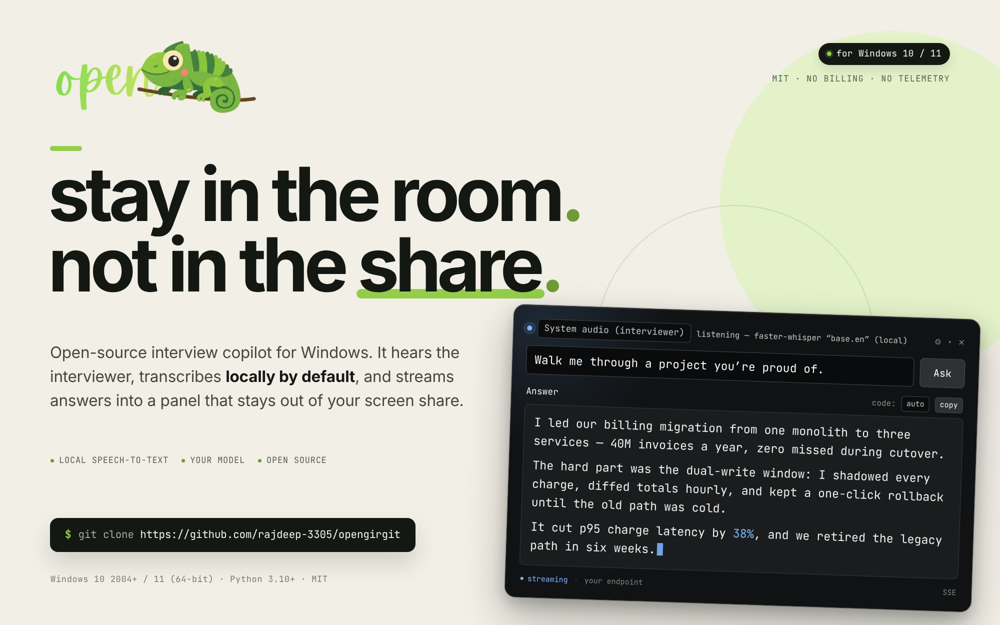

# OpenGirGit

<p align="center">
  
</p>

<p align="center"><sub>Interface mock-up: the overlay listening, with a streamed answer.</sub></p>

An open-source **interview-copilot overlay**: it listens to the interviewer through
your speakers, transcribes speech in real time, and streams AI answers into a
small always-on-top panel that you can keep out of screen shares.

OpenGirGit is a **clean-room, MIT-licensed re-implementation** of the architecture
used by the commercial Windows app *GirGit AI*, written from observed behaviour
(the reverse-engineering notes stay in the maintainer's working copy and are not
published). It contains **no vendor code, no vendor keys, and no billing** — you
run your own server, plug in your own model, and pay nobody.

*Girgit* is Hindi for **chameleon** — which is what the logo shows: a little
chameleon perched on a branch. It doubles as the design brief, since this app
knows how to stay out of a screen share.

> **New here — just want to install it?** There's a plain-language,
> no-coding-needed **[install & setup guide](docs/SETUP.md)** for Windows
> (install → point it at a free local model → done).

```
┌──────────────── your machine ─────────────────┐        ┌─────── optional ───────┐
│  client/  (PySide6 overlay)                   │        │ OpenAI / OpenRouter    │
│   ├ WASAPI loopback / mic capture             │        │ Ollama / LM Studio     │
│   ├ local faster-whisper STT  ────────────────┼───┐    │ any OpenAI-compatible  │
│   └ SSE chat + vision stream ─────────────────┼─┐ │    └────────────────────────┘
└───────────────────────────────────────────────┘ │ │              ▲
                                                  │ │              │
┌──────────────── server/ (FastAPI) ──────────────┼─┴──────────────┘
│  OTP auth · profiles · chat/vision SSE proxy    │
│  resume parsing · optional Deepgram token mint  │   ── wss://api.deepgram.com (opt-in)
└─────────────────────────────────────────────────┘
```

---

## Table of contents

- [Features](#features)
- [What is *not* in this repo](#what-is-not-in-this-repo)
- [Repository layout](#repository-layout)
- [Quick start](#quick-start)
  - [One command (recommended)](#one-command-recommended)
  - [Manual setup](#manual-setup)
- [Configuration](#configuration)
  - [Server environment](#server-environment)
  - [Client settings](#client-settings)
- [Global hotkeys](#global-hotkeys)
- [Privacy and stealth notes](#privacy-and-stealth-notes)
- [Relationship to the original app](#relationship-to-the-original-app)
  - [How OpenGirGit compares today](#how-opengirgit-compares-today)
- [Development](#development)
- [Roadmap](#roadmap)
- [License](#license)

---

## Features

| Area | What OpenGirGit does |
|---|---|
| **Speech input** | Captures **system audio loopback** through WASAPI — or a regular microphone — and resamples everything to 16 kHz mono. |
| **Transcription** | **Local** [faster-whisper](https://github.com/SYSTRAN/faster-whisper) by default (nothing leaves your machine), or **Deepgram** streaming over a direct WebSocket using a short-lived token minted by *your* server. The local engine also fills the box **while the speaker is talking** (re-transcribes every ~1.2 s, with adaptive back-off on slow machines). |
| **Answers** | Streaming chat from any **OpenAI-compatible** endpoint (OpenAI, OpenRouter, Groq, Ollama, LM Studio, vLLM…), over **SSE** or the optional **WebSocket** transport (auto, with SSE fallback). Answers render as streaming Markdown with **syntax-highlighted code blocks**, tables, **LaTeX math** (KaTeX) and **mermaid diagrams** — rendered by a bundled, fully offline web view (no CDN). The `code:` combo rewrites the shown answer's code in the picked language and **caches each variant per answer**. |
| **Vision** | Hotkey → select a screen region. Each selection is **queued as a removable thumbnail**, so several regions (up to 5, e.g. a problem statement and its examples) can be attached to one question; the next question you type, speak or Ask carries them to a vision-capable model ("solve the coding problem on screen"). |
| **Context** | Resume (PDF/DOCX/TXT), company, job description and free-form notes are formatted into a context block that is attached to every request. The JD and notes boxes also accept **attached files**: documents are text-extracted locally (never uploaded), images are transcribed by the vision model and folded in. |
| **History** | Conversation history is stored **locally** in `~/.opengirgit/`, browsable in a dialog (sessions are named after their first question), navigable with hotkeys, and **exportable to Markdown** (one session or all of it, or straight to the clipboard). |
| **Overlay UX** | Frameless, always-on-top, translucent, draggable bar with a short slide animation for collapse/expand and a startup fade; **click-through mode** (the mouse works through the overlay to the app underneath — `Shift+Alt+C` returns control); a **streaming preview popup** teases the answer while the panel is collapsed; tabbed settings (Server / Speech / Behaviour / Hotkeys); opacity and move hotkeys; resize grip; hi-DPI-aware thumbnails and an optional **interface scale** for 100–200 % sessions. |
| **Hotkeys** | 15 global actions (the original's 14 plus click-through), editable **in the settings dialog** (empty value disables one) with validation. |
| **Languages** | The interface ships an offline translation layer (English + German today) with `auto` following the desktop locale; adding a language is dropping one JSON file in [`client/opengirgit/translations/`](client/opengirgit/translations/README.md) — no Qt/`.qm` toolchain needed. |
| **Stealth** | The windows are excluded from capture (`SetWindowDisplayAffinity`, `WDA_EXCLUDEFROMCAPTURE`) and hidden from the taskbar/Alt-Tab. During region selection the real cursor is blanked and a stand-in copy stays parked at the anchor, so a screen share sees an ordinary motionless cursor. |
| **Auth** | Local email-OTP accounts issued by your own server (SMTP optional — dev mode prints the code). |
| **Packaging** | `run.ps1` bootstraps everything with one command; CI builds a PyInstaller **one-folder Windows build** (client + server in one exe) and a **per-user installer** (Inno Setup, no admin prompt, German + English wizard) on release tags. |
| **Zero billing** | There is no payment code, no minute accounting and no phone-home anywhere in this repository. |

## What is *not* in this repo

* **No vendor binaries, strings, assets or decompiled code.** Everything here was
  written from scratch from the original's *observable behaviour* — the
  reverse-engineering notes are kept locally and deliberately not published.
* **No subscription/billing/payment logic.** The original debits ₹5 ≈ 1 minute of
  usage per 60-second heartbeat and sells prepaid minute packs through Razorpay;
  none of that exists here, and no code from it was reused.
* **No telemetry, no auto-update, no remote kill-switch.**

## Repository layout

```
opengirgit/
├── README.md                  ← you are here
├── LICENSE                    ← MIT
├── run.ps1                   ← one-command launcher (venv + deps + server + client)
├── docs/
│   ├── SETUP.md               ← plain-language install & setup guide (start here)
│   └── API.md                 ← HTTP/SSE/WS API reference implemented by server/
├── tools/
│   └── collect_strings.py     ← regenerates the translation catalog (en.json)
├── packaging/                 ← PyInstaller spec + frozen entry point
│   ├── opengirgit.spec
│   ├── launcher.py            ← starts bundled server, then the client
│   └── README.md
├── server/                    ← FastAPI backend (auth, LLM proxy, STT tokens)
│   ├── app/
│   │   ├── main.py            ← routes (incl. the /api/llm/ws WebSocket)
│   │   ├── config.py          ← pydantic-settings (env + .env)
│   │   ├── security.py        ← OTP hashing, JWT
│   │   ├── db.py              ← SQLite (users, OTPs, feedback)
│   │   ├── llm.py             ← OpenAI-compatible client (stream + complete)
│   │   ├── prompts.py         ← system prompt + context assembly
│   │   ├── resume.py          ← resume → structured JSON
│   │   └── stt.py             ← optional Deepgram temp-token minting
│   ├── run.py
│   ├── requirements.txt
│   └── .env.example
├── client/                    ← PySide6 desktop overlay
│   ├── opengirgit/
│   │   ├── app.py             ← bootstrap & wiring (locale, scale, transport)
│   │   ├── overlay.py         ← the overlay window (answers, thumbnails)
│   │   ├── dialogs.py         ← login / info / tabbed settings / history / feedback
│   │   ├── api.py             ← HTTP client (auth, SSE + WebSocket streaming, retries)
│   │   ├── workers.py         ← QThread helpers
│   │   ├── audio.py           ← WASAPI loopback / mic capture
│   │   ├── dsp.py             ← downmix + linear resampler (pure numpy)
│   │   ├── stt.py             ← local faster-whisper (with partials) & Deepgram
│   │   ├── capture.py         ← screen region selection (live + frozen modes) + decoy cursor
│   │   ├── decoy.py           ← share-safe cursor (GDI bitmap / drawn arrow)
│   │   ├── render.py          ← markdown → HTML; math/mermaid extraction for the web view
│   │   ├── webview.py         ← optional QtWebEngine answer view (KaTeX + mermaid)
│   │   ├── assets/            ← vendored KaTeX + mermaid JS/CSS/fonts (MIT, offline)
│   │   ├── i18n.py            ← tiny offline catalog-based translation layer
│   │   ├── translations/      ← en.json (inventory) + de.json (+ README for translators)
│   │   ├── stealth.py         ← WDA_EXCLUDEFROMCAPTURE / tool-window
│   │   ├── hotkeys.py         ← global hotkeys + validation
│   │   ├── prompts.py         ← context formatting
│   │   ├── resume.py          ← PDF/DOCX/TXT text extraction
│   │   ├── stores.py          ← ~/.opengirgit JSON stores (+ Markdown export)
│   │   └── config.py          ← settings dataclass
│   ├── main.py
│   ├── requirements.txt
│   └── .env.example
├── tests/                     ← offline unit tests (server units + client units)
│   └── e2e/                   ← mock OpenAI-compatible model + end-to-end script
└── .github/workflows/         ← ci.yml (lint/tests/e2e) + release.yml (Windows bundle + installer)
```

## Quick start

Requirements: **Windows 10 2004+ or Windows 11 (64-bit)** and Python **3.10+**
(3.11–3.13 recommended). Windows is the only supported target — capture
exclusion is the core of the product and Win32 is where it exists. Linux and
macOS are out of scope (see the [platform table](#platform-support)).

### One command (recommended)

```powershell
.\run.ps1                # Windows PowerShell: venv + deps + server + client
.\run.ps1 --check        # validate prerequisites only
```

The script creates a shared `.venv`, installs everything (once; re-runs are
instant), starts the API server, waits for `/api/health`, then opens the client.
`HOST`, `PORT`, `PYTHON` and `OPENGIRGIT_SERVER_URL` override the defaults;
`--no-server` / `--no-client` run only one half.

Prebuilt **Windows** bundles (one folder, client + server, no Python needed) and
a **per-user installer** (`OpenGirGit-windows-x64-setup.exe`, no admin prompt,
English/German wizard) are attached to GitHub releases by CI. See
[`packaging/`](packaging/README.md) for building your own.

### Manual setup

#### 1. Server

```bash
cd server
python -m venv .venv
source .venv/bin/activate          # Windows: .venv\Scripts\activate
pip install -r requirements.txt
cp .env.example .env               # then edit .env
python run.py                      # http://127.0.0.1:8000
```

Minimum `.env` for a cloud model:

```ini
LLM_BASE_URL=https://api.openai.com/v1
LLM_API_KEY=sk-...
LLM_CHAT_MODEL=gpt-4o-mini
LLM_VISION_MODEL=gpt-4o-mini
```

or, fully local, with [Ollama](https://ollama.com):

```ini
LLM_BASE_URL=http://127.0.0.1:11434/v1
LLM_API_KEY=ollama
LLM_CHAT_MODEL=llama3.1:8b
LLM_VISION_MODEL=llava:latest
```

Health check: `curl http://127.0.0.1:8000/api/health`

> **OTP dev mode.** Without SMTP configured the server returns the login code in
> the API response and prints it in the console (the client fills it in
> automatically). Set `SMTP_HOST` … to send real email, or set
> `ALLOW_DEV_OTP_ECHO=false` to disable the echo. A non-loopback `HOST` refuses
> to start while the echo is on without SMTP, and while `JWT_SECRET` is still
> the shipped default (or shorter than 32 characters).

#### 2. Client

```bash
cd client
python -m venv .venv
source .venv/bin/activate          # Windows: .venv\Scripts\activate
pip install -r requirements.txt
cp .env.example .env               # optional; defaults work for a local server
python main.py
```

First launch: the login dialog asks for your **server URL**, **email** and the
**one-time code** (auto-filled in dev mode). After that the interview-info dialog
opens once per session to collect company/JD/resume.

**Windows system audio.** Play something, then click the 🎙 button and pick the
`… (loopback)` entry for your output device — that is the interviewer's voice.
Pick a plain input device to use your microphone instead.

**Local STT models.** The first transcription downloads the faster-whisper model
(`WHISPER_MODEL`, default `base.en`) from Hugging Face and caches it. `tiny.en`
is fastest, `small.en`/`medium.en` are more accurate.

## Configuration

### Server environment

All server settings are environment variables (or `server/.env`); see
`server/.env.example` for the annotated list.

| Variable | Default | Meaning |
|---|---|---|
| `HOST` / `PORT` | `127.0.0.1` / `8000` | Bind address. Use `0.0.0.0` to serve other machines. |
| `DATA_DIR` | `data` | SQLite location. |
| `JWT_SECRET` | `dev-secret-change-me-use-32-bytes-minimum` | **Change this.** HMAC key for access tokens (≥32 chars); a non-loopback bind refuses to start with the default. |
| `JWT_EXPIRE_MINUTES` | `10080` | Token lifetime (7 days). |
| `OTP_TTL_SECONDS` / `OTP_MAX_ATTEMPTS` / `OTP_RATE_LIMIT_SECONDS` | `300` / `5` / `30` | OTP policy. |
| `ALLOW_DEV_OTP_ECHO` | `true` | Return the OTP in the response **when no SMTP is configured**; a non-loopback bind refuses to start with this on. |
| `CORS_ORIGINS` | empty | Comma-separated browser origins; empty = CORS **off** (the desktop client needs none). |
| `SMTP_HOST`, `SMTP_PORT`, `SMTP_USER`, `SMTP_PASSWORD`, `SMTP_FROM`, `SMTP_STARTTLS` | – | Real email delivery. |
| `LLM_BASE_URL` | `https://api.openai.com/v1` | Any OpenAI-compatible base URL. |
| `LLM_API_KEY` | – | Bearer key for the LLM endpoint. |
| `LLM_CHAT_MODEL` | `gpt-4o-mini` | Default chat model (the client may override). |
| `LLM_VISION_MODEL` | `gpt-4o-mini` | Default model for screenshots. |
| `LLM_TEMPERATURE` / `LLM_MAX_TOKENS` | `0.3` / `1024` | Generation defaults. |
| `LLM_TIMEOUT_SECONDS` | `120` | Read timeout for streaming requests. |
| `SYSTEM_PROMPT` | built-in | Override the persona/system prompt. |
| `DEEPGRAM_API_KEY` | – | If set, `/api/stt/token` mints short-lived Deepgram tokens. |
| `DEEPGRAM_MODEL` / `DEEPGRAM_LANGUAGE` | `nova-2` / `en` | Deepgram stream parameters. |
| `DEEPGRAM_TOKEN_TTL_SECONDS` | `600` | Minted token lifetime. |
| `APP_VERSION` | `0.2.0` | Reported by `/api/version`. |

### Client settings

Client settings live in `client/.env` (first run) and are then persisted to
`~/.opengirgit/config.json`, editable from the **⚙ settings** dialog:

| Key | Default | Meaning |
|---|---|---|
| `server_url` | `http://127.0.0.1:8000` | Your OpenGirGit server. |
| `stt_engine` | `local` | `local` (faster-whisper) or `deepgram`. |
| `whisper_model` | `base.en` | faster-whisper model name. |
| `whisper_compute_type` | `int8` | `int8`, `int8_float16`, `float16`, `float32`. |
| `language` | `en` | Transcription/speech language hint. |
| `silence_seconds` | `0.9` | Silence that ends an utterance (0.2–3.0). Lower = transcript appears sooner but questions may split. |
| `audio_source` | `system` | `system` (loopback) or `microphone`. |
| `audio_device` | *(auto)* | Device id from the dropdown; empty selects the default. |
| `auto_ask` | `true` | Submit a question automatically when a final transcript arrives. |
| `partials` | `true` | Live partial transcripts while the local engine is transcribing. |
| `decoy_cursor` | `true` | Hide the real cursor during region selection (see stealth notes). |
| `web_render` | `true` | Render LaTeX math and mermaid diagrams in the embedded QtWebEngine view (falls back to plain text when unavailable; set `false` to save memory). |
| `opacity` | `0.96` | Overlay opacity. |
| `screenshot_prompt` | built-in | Prompt used when you attach screenshot(s) with no typed question. |
| `chat_transport` | `auto` | `auto` (WebSocket, falls back to SSE) · `sse` · `websocket`. |
| `ui_language` | `en` | Translation catalog code (`en`, `de`, …) or `auto` for the desktop locale. |
| `ui_scale` | `0` | Interface scale in percent (`0` follows the system/session DPI; 100–200 preset). Applied at startup — takes effect after a restart. |
| `hotkeys` | see below | Hotkey combos as `"Shift+Alt+K"` strings; editable in the settings dialog (an empty value disables a hotkey). |

Files written by the client: `~/.opengirgit/{config,credentials,context,conversations,resume_cache}.json`.
`credentials.json` contains a bearer token: the client prefers the **OS keyring**
(Windows Credential Manager) and only falls back to the plaintext file, which is
written **owner-only** (`0600`) like the other store files. Keep it out of version control (the repository
`.gitignore` already ignores it).

## Platform support

OpenGirGit targets **Windows 10 2004+ / Windows 11 (64-bit)** only. Stealth is
the point of the product, and Win32 capture exclusion is the only supported way
to get it. Linux and macOS are out of scope: there are no builds, no install
guides, and no support claims for them.

| Capability | Windows |
|---|---|
| Overlay, dialogs, streaming answers | ✅ |
| Region screenshots | ✅ native grab |
| System-wide hotkeys | ✅ `RegisterHotKey` |
| System-audio loopback | ✅ WASAPI |
| Capture exclusion (screen-share invisibility) | ✅ `WDA_EXCLUDEFROMCAPTURE` |
| Taskbar / Alt-Tab hiding | ✅ `WS_EX_TOOLWINDOW` |

The source is portable Python and still runs on Linux for development, but the
system-audio, global-hotkey and stealth backends exist only on Windows.

## Global hotkeys

Defaults (all remappable in the settings dialog or `config.json`). They are
**system-wide** on Windows through `RegisterHotKey`, with OS key-repeat
suppressed for the tap-style actions:

| Action | Default | Notes |
|---|---|---|
| Collapse / expand answers | `Shift+Alt+H` | |
| Ask AI (submits the manual box) | `Shift+Alt+A` | OS key-repeat suppressed |
| Erase inputs | `Shift+Alt+D` | OS key-repeat suppressed |
| Screenshot region (repeat to attach several) | `Shift+Alt+S` | opens a selection overlay; each region is queued as a thumbnail |
| Click-through (mouse works through the overlay) | `Shift+Alt+C` | session-only; the same hotkey brings clicks back |
| Previous / next answer | `Shift+Alt+[` / `Shift+Alt+]` | |
| Scroll answer up / down | `Shift+Alt+W` / `Shift+Alt+X` | hold to repeat |
| Move overlay up/down/left/right | `Shift+Alt+I` / `K` / `J` / `L` | hold to repeat |
| Opacity down / up | `Shift+Alt+-` / `Shift+Alt+=` | hold to repeat |

## Privacy and stealth notes

* **Where your data goes.** Audio → only to the STT engine you chose (local
  faster-whisper by default; Deepgram if enabled). Questions/screenshots →
  only to the LLM endpoint your server is configured with. No third party
  receives anything else.
* **Screen-share invisibility.** Every OpenGirGit window calls
  `SetWindowDisplayAffinity(hwnd, WDA_EXCLUDEFROMCAPTURE)`, which excludes it
  from `BitBlt`-style capture used by Zoom/Teams/Meet, and sets
  `WS_EX_TOOLWINDOW` so it stays out of the taskbar and Alt-Tab. This needs
  Windows 10 version 2004 (build 19041) or newer; on older builds the flag
  degrades and the window appears as a black rectangle in shares — the same
  caveat the original has. Unsupported platforms have no capture exclusion at
  all; do not rely on stealth there.
* **Decoy cursor (`decoy_cursor=true`).** While you drag the screenshot region,
  the real pointer is blanked on the selection overlay and a stand-in copy
  (the actual system cursor bitmap on Windows, read via GDI) stays parked at
  the button you pressed, so a screen share sees a normal, motionless cursor
  instead of a crosshair sweeping the screen; when you finish, the real cursor
  is glided back to the anchor.
* **Ethics.** You are responsible for complying with the rules of whatever
  interview, exam or call you use this in. Many employers and testing platforms
  forbid assistive tooling; nothing in this repository is designed to defeat
  human-perceptible detection (the stealth flag is a documented OS window
  attribute, not a hook or a cheat), and no warranty of any kind is provided.

## Relationship to the original app

OpenGirGit 1.x was written from a reverse-engineering study of *GirGit AI* 1.2.45
(PyInstaller + PySide6, Windows) — its shipped artifacts and public endpoints.
That study (kept locally, not published) produced the architecture reproduced here
as original code: system-audio loopback → direct Deepgram WS with server-minted
tokens; SSE/WS LLM chat with a server-side system prompt; client-side context
blob; capture-excluding overlay windows.

**Billing, per the study:** the only purchase mechanism in the original is
prepaid usage at **₹5 per minute** (`rate_per_minute_paise=500`), sold in minute
packs (min 15, max 1000) through Razorpay, with a **60-second heartbeat that
debits 1 minute** per beat and a 10-minute server-side free trial. There is no
recurring subscription and no 5-minute billing unit anywhere in the binaries —
"5 minutes" only ever matches the "₹5/min" rate. OpenGirGit removes this layer
entirely: your server bills nothing.

### How OpenGirGit compares today

**Ahead of the original**

* **Cost** — ₹0 forever; the original debits ₹5/min from a prepaid balance.
* **Privacy** — local STT and, optionally, a local LLM; the original always
  routes audio to Deepgram and every question to its own backend. No telemetry,
  file logs, feedback pings or auto-updates here.
* **Offline and longevity** — fully offline with Ollama + faster-whisper; the
  original stops working when `girgit-ai.com` does.
* **Openness** — MIT, auditable, forkable; no trial timer, device binding or
  vendor lock-in, and you choose the model.

**Roughly at parity**

* Core flow (overlay, the original's 14 hotkeys plus a click-through toggle,
  capture exclusion, loopback capture, screenshot→vision, resume/JD context,
  streaming answers, history), live partial transcripts, decoy cursor during
  selection, editable hotkeys.
* **Click-through mode, collapsed-answer streaming preview and a startup
  pre-warm** of the DNS/TLS/WebSocket path — the original's remaining overlay
  touches, reproduced here, plus fluid animations for the panel, the preview
  and the startup fade.
* **Per-answer code-language switcher**: picking Python/C++/Java/JavaScript…
  re-asks the model for the shown answer with the code in that language,
  caches the result per answer (`auto` returns to the original), and lets a
  pick made before a question ride along as an instruction.
* **File attachments for the interview context**: the job-description and
  notes boxes take documents (extracted locally) and images
  (vision-transcribed), not just pasted text.
* **Math (LaTeX) and mermaid diagrams** render in an embedded web view, exactly
  like the original — with KaTeX and mermaid vendored locally (MIT), so unlike
  a CDN-based renderer it keeps working offline.
* **Multi-region screenshots**: each capture is queued as a removable thumbnail
  (up to 5) and the next question carries them all to the vision model.
* **WebSocket chat transport** in addition to SSE (auto-upgrade with SSE
  fallback, cancellation, retries) — the original only speaks WebSocket.
* **Session export to Markdown** — one session, the whole history or straight to
  the clipboard; the original keeps history inside its own UI only.
* **Interface translations**: a dependency-free, offline catalog layer — English
  and German ship today, and adding a language is one JSON file.
* Latency when configured equivalently (Deepgram + cloud LLM): the plumbing
  adds ~20 ms end-to-end (see measurements below).

**Where the original is still ahead**

* **Code-signed distribution**: our folder, installer and exe are all unsigned,
  so Windows SmartScreen shows a one-time "unknown publisher" prompt. Signing
  needs a paid certificate, which free CI does not provide.
* **Custom visual design** (hand-drawn art, animations, bespoke icon set) — our
  polish work covers typography, DPI handling and states, not illustrations.
* **Default answer quality** depends on the model you point it at; there is no
  vendor-tuned default stack.

Nothing here claims superior transcription or answer quality — those follow
from the engine and model you configure.

## Development

```bash
pip install pytest ruff
pip install -r server/requirements.txt    # needed by the server tests
pip install numpy PySide6                 # optional: dsp + offscreen UI tests
pytest                                    # 161 offline tests, no network needed
ruff check server client tests packaging tools
python tools/collect_strings.py --check   # translation inventory is in sync
```

Test layout:

| File | Covers |
|---|---|
| `tests/test_server_prompts.py` | system prompt, history filtering, vision payloads |
| `tests/test_server_security.py` | OTP hashing, JWT issue/verify/expiry/refresh leeway |
| `tests/test_server_resume.py` | JSON extraction + normalisation of parsed resumes |
| `tests/test_server_ws.py` | the `/api/llm/ws` WebSocket endpoint: auth, chat/vision frames, validation, error frames |
| `tests/test_client_dsp.py` | down-mix, resampling (single-pass == chunked), levels |
| `tests/test_client_config.py` | settings defaults, clamping, env overrides, context formatting |
| `tests/test_client_stores.py` | bounded history, atomic writes, credential fallback, Markdown export |
| `tests/test_client_audio.py` | device hints for missing loopback/microphone inputs |
| `tests/test_client_i18n.py` | catalog loading/fallback, German completeness, placeholder parity, `collect_strings --check` |
| `tests/test_client_hotkeys.py` | hotkey parsing + editor validation (skipped without PySide6) |
| `tests/test_client_api.py` | SSE assembly, WebSocket transport (auto/forced, cancel, fallback), retry policy, URLs |
| `tests/test_client_render.py` | markdown→HTML rendering, pygments highlighting, math/mermaid extraction, fallback |
| `tests/test_client_webview.py` | KaTeX + mermaid rendering in the embedded QtWebEngine (offscreen; skipped without WebEngine) |
| `tests/test_client_ui.py` | headless (offscreen) construction, streaming, capture queue, web-view swap, thumbnails, decoy cursor, dialogs, export, retranslation |
| `tests/e2e/run_e2e.py` | boots the real server + mock model and drives the client HTTP layer (SSE + WebSocket) |
| `tests/e2e/stt_smoke.py` | optional live STT check (file replay or live capture, needs faster-whisper) |

The UI tests run under `QT_QPA_PLATFORM=offscreen` and are automatically skipped
when PySide6 is not installed. On top of the unit tests there is an end-to-end
check that boots the mock OpenAI-compatible model plus the real server and drives
the real client HTTP layer (`python tests/e2e/run_e2e.py`) — CI runs it on every
push. Tests never touch the network, Qt or optional heavy dependencies except
where noted above; client DSP is exercised through `client/opengirgit/dsp.py`,
which is deliberately dependency-light (numpy only).

### Verifying speech-to-text on your machine

The unit tests never load a model. To exercise the real pipeline end-to-end
(down-mix → resample → voice-activity segmentation → faster-whisper):

```bash
pip install faster-whisper        # already in client/requirements.txt

# replay an audio file (16-bit PCM; any sample rate / channel count):
python tests/e2e/stt_smoke.py --wav speech.wav --model base.en --expect "hello"

# real-time replay + latency measurement with a specific silence gate:
python tests/e2e/stt_smoke.py --wav speech.wav --model tiny.en --realtime --silence 0.4

# live capture — system audio loopback (WASAPI):
python tests/e2e/stt_smoke.py --capture 8 --source system

# live capture from a microphone on an explicit device:
python tests/e2e/stt_smoke.py --capture 8 --source microphone --device input:3
```

On the default `system` source the script picks the default WASAPI loopback
device itself.

The first run downloads the model; the script exits 0 only when a transcript
(and the `--expect` substring, if given) came back.

### Verifying math/diagram rendering on your machine

```bash
# source tree
python -m opengirgit --check-render

# packaged build (no display needed; runs headless)
dist/OpenGirGit/OpenGirGit.exe --check-render
```

This starts the embedded browser headlessly, renders a sample answer with KaTeX
+ mermaid and prints `KaTeX nodes: 2  mermaid SVGs: 1`; exit code 0 means both
rendered. If it reports `assets are missing`, reinstall/rebuild the client — the
vendored JS lives in `client/opengirgit/assets/` (`web_render=false` disables
the web view entirely, which is also a valid way to run on weak machines).

### Latency notes

Measured on an ordinary CPU (no GPU), 16 kHz input replayed in real time, an
11-second utterance — the window from the speaker stopping to the transcript
landing in the box:

| Model | `silence_seconds=0.9` (default) | `silence_seconds=0.4` |
|---|---|---|
| `tiny.en` | ~1.25 s | ~0.8 s |
| `base.en` | ~1.55 s | ~1.1 s |

That window is the silence gate plus transcription (greedy decode, no VAD
lookahead). Beyond it, the app itself adds ~20 ms between submit and the first
streamed answer token — everything else is your LLM's own speed. With
`auto_ask=true` (default) the question is sent the moment the transcript
arrives; with `auto_ask=false` it waits in the box for Enter or the `ask`
hotkey. With the default local engine the box also fills **while the speaker is
still talking** (re-transcription every ~1.2 s, automatically throttled on slow
machines; disable with `partials=false`). Deepgram remains the word-level
lowest-latency option.

### Verification status

Windows-specific paths are tracked in
**[`docs/WINDOWS-CHECKLIST.md`](docs/WINDOWS-CHECKLIST.md)** (launcher, WASAPI
loopback, stealth, decoy cursor, hotkeys under a meeting app, the packaged exe).
The CI **windows-tests** job installs the client requirements on
`windows-latest` and runs the core suite as a first line of defence.

| Area | Verification |
|---|---|
| Server (auth, profiles, SSE chat/vision, resume, limits) | ✅ unit tests + live HTTP smoke + `run_e2e.py` |
| Client HTTP (auth, chat, vision, resume, error paths, retries) | ✅ live against the real server and the mock model; retry semantics unit-tested |
| DSP chain (down-mix → resample → PCM16) | ✅ unit tests + real audio replay |
| Local STT (faster-whisper) | ✅ real speech clip transcribed word-perfect via `stt_smoke.py`, both 16 kHz mono and 48 kHz stereo through the capture chain |
| Live partials (local engine) | ✅ real speech clip, real-time replay: 9 partial updates during an 11 s utterance |
| Answer rendering (pygments highlighting, tables, fallback) | ✅ unit tests + offscreen render |
| Math (KaTeX) + mermaid rendering | ✅ offscreen WebEngine test: formulas become KaTeX nodes, the diagram renders as an SVG, code blocks round-trip untouched; ⏳ appearance inside the capture-excluded overlay on Windows |
| Math/diagram self-test (`--check-render`) | ✅ from source and inside a PyInstaller one-folder build; the release workflow runs it on the Windows exe (non-fatal step) |
| Screenshot thumbnails | ✅ offscreen UI tests |
| Multi-region screenshots | ✅ queue/cap/remove/attach tests + `run_e2e.py` sends two images in one vision request; ⏳ Windows capture flow |
| Decoy cursor (region selection) | ✅ blank/dummy/glide logic + pixmap fallback offscreen; ⏳ GDI bitmap and share appearance on Windows |
| Hotkey editor | ✅ validation + save flow offscreen; registration path unchanged |
| Click-through toggle | ✅ state machine + portable `WindowTransparentForInput` fallback (offscreen), refusal without a hotkey; ⏳ real click pass-through on Windows |
| Streaming preview popup | ✅ show/update/linger/hide while collapsed, teaser cleaning (offscreen); ⏳ on-screen placement |
| Startup pre-warm | ✅ health probe + WebSocket handshake with stubbed transports, failures swallowed; ⏳ latency delta against a live provider |
| UI animations (collapse, preview, startup fade) | ✅ end-state tests offscreen; ⏳ visual smoothness on Windows |
| Feedback dialog | ✅ payload test + offscreen send flow |
| WebSocket transport | ✅ in-process server tests (auth, chat/vision frames, validation, error frames) + `run_e2e.py` streams chat/vision over WS and cancels mid-stream + verified against the **frozen bundle** (chat over ws/sse/auto, vision over ws, unauthenticated socket rejected); ⏳ reverse-proxied `wss://` deployments |
| Session export to Markdown | ✅ store + dialog tests (file written, clipboard, empty case); sessions are auto-named after their first question (truncation, empty and explicit-title cases tested) |
| Code-language rewrites (per-answer variants) | ✅ rewrite/cache/restore/instruction/failure paths offscreen + variant persistence in the store; ⏳ visual check against a live provider |
| Context file attachments | ✅ document extraction (no model call), image JPEG re-encode, stubbed vision transcription and save flow offscreen; ⏳ a real model transcribing a photographed page |
| Translations (i18n) | ✅ catalog/fallback/placeholder tests, offscreen German retranslation; ⏳ native-speaker review of the German values |
| Server security policy | ✅ HMAC-hashed OTPs (`compare_digest`), per-email send cooldown, attempt cap, JWT claim validation; non-loopback binds refuse to start with the default secret or the dev OTP echo; CORS off unless configured; client stores written owner-only; unit-tested |
| Interface scale / hi-DPI | ✅ setting plumb-through + DPR-aware thumbnails; ⏳ visual review at 125–200 % |
| Pixel polish (states, scrollbars, tabs) | ✅ hover/focus/checked styles, themed scrollbars and tooltips, tabbed settings — offscreen construction tests; ⏳ visual pass on Windows at 100–150 % |
| One-command launcher | ⏳ `run.ps1` on Windows: venv check, server start, health wait, clean shutdown |
| Packaged bundle (PyInstaller + CI) | ✅ the PyInstaller spec, vendored assets and the `--check-render` self-test were exercised in a one-folder build; the release workflow builds the Windows bundle and installer on release tags; ⏳ hands-on Windows pass with the CI-built zip |
| Windows installer (Inno Setup, per-user) | ✅ CI compiles and attaches `…-setup.exe` on release tags; per-user layout, shortcuts, uninstaller and license page are declarative; ⏳ install → launch → upgrade → uninstall on real Windows |
| TLS trust-store fallback + classified connection errors | ✅ unit tests: a certificate error is retried once against the OS-store ∪ certifi bundle on all three transports, then reported as a TLS diagnostic; DNS/refused/handshake failures get distinct messages; ⏳ a real corporate-proxy/antivirus environment |
| GUI flows (offscreen Qt) | ✅ construction, streaming, hotkey wiring, teardown |
| WASAPI loopback capture (pyaudiowpatch, Windows-only) | ⏳ run `stt_smoke.py --capture 8 --source system` |
| Native hotkeys (`RegisterHotKey`) | ✅ all 15 defaults parse and validate; ⏳ native registration on Windows |
| Stealth (`WDA_EXCLUDEFROMCAPTURE`, Windows-only) | ⏳ verify with a screen-share |
| Deepgram engine | ⏳ needs an API key (`stt_engine=deepgram`) |
| Real model provider | ✅ any OpenAI-compatible endpoint (mock used in CI; point `.env` at your provider) |

## Roadmap

- [x] Streaming partial transcripts from local whisper (chunked re-transcription).
- [x] Math (LaTeX, KaTeX) and mermaid diagram rendering via a bundled offline web view.
- [x] Multi-region screenshots (queued thumbnails; up to 5 images per question).
- [x] Optional WebSocket chat transport (auto-upgrade, SSE fallback, cancellation).
- [x] Session export to Markdown (one session, all sessions, clipboard).
- [x] Translation layer with drop-in JSON catalogs (English + German shipped).
- [x] Interface scale setting + hi-DPI thumbnails, tabbed settings, themed controls.
- [x] Click-through mode, collapsed-answer streaming preview, startup pre-warm and fluid animations.
- [x] Focused Windows-only scope: stealth is the product, so unsupported platforms are no longer shipped or documented.
- [x] Per-user Windows installer (Inno Setup, no admin prompt) with app icon, built by CI on release tags.
- [x] OS-trust-store TLS fallback (corporate proxies / antivirus roots) with classified connection errors; history sessions auto-titled.
- [ ] Verify and iterate the Windows bundle and installer on real hardware (CI builds both on tags).
- [ ] A third-party translation PR flow (the German catalog has not been native-reviewed).
- [ ] Optional packaging nicety: a version interstitial without auto-update.

## License

MIT — see [`LICENSE`](LICENSE). No vendor code, strings, assets or binaries from
the original application are included or redistributed. "GirGit AI" is only
referenced descriptively for interoperability research; this project is not
affiliated with or endorsed by its authors.

Release bundles redistribute third-party components (Qt/PySide6 under LGPL-3.0,
vendored KaTeX/mermaid under MIT, …) — each under its own license, listed in
[`THIRD-PARTY-NOTICES.md`](THIRD-PARTY-NOTICES.md).
